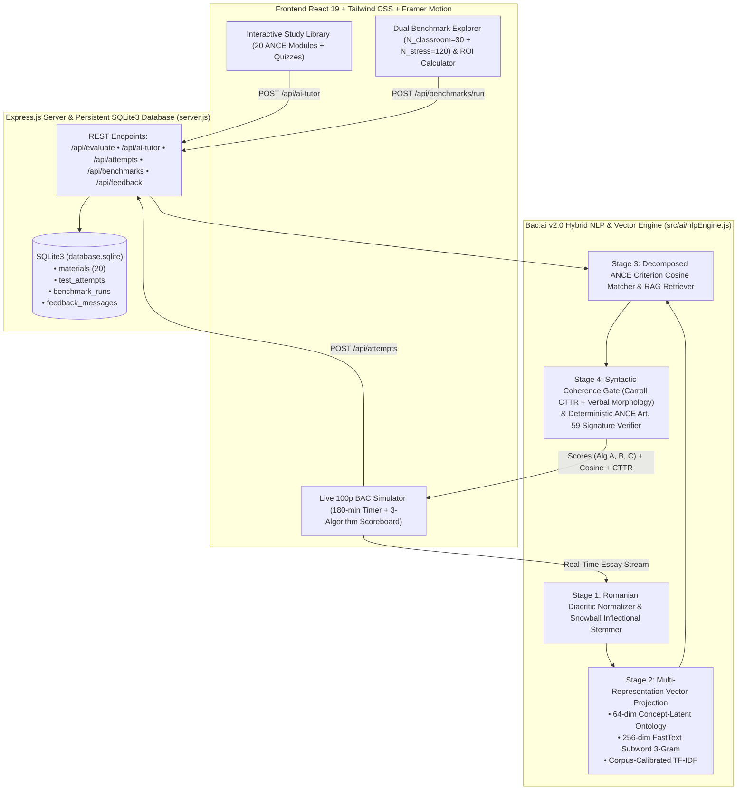

# MoldSEF & Infomatrix Official Documentation — Template A (Part 2 of 2: Separate File)
## 1-Page Visual Annex (System Architecture, Dual Benchmark Charts & Economic ROI • < 1 MB)

- **Project Title:** **Bac.ai v2.0 — Hybrid Rubric-Grounded Semantic Vector & Syntactic Coherence Engine (ANCE 100p)**
- **Author:** **Ana Mitrofan** (Individual R&D Project • Republic of Moldova)

---

### Figure 1: 5-Stage Hybrid NLP System Architecture & Persistent SQLite Pipeline

---

### Figure 2: Real-World 12th-Grade Classroom Field Validation ($N_{\text{classroom}} = 30$ Unscripted Answers, Blind Dual-Teacher Grading $r = 0.9711$)

| Classroom Validation Metric ($N_{\text{classroom}} = 30$) | Algorithm A: Heuristic Keyword v1 | Algorithm B: Zero-Shot Vector | Algorithm C: Bac.ai v2 Hybrid (Proposed) | Relative Gain (Alg C) |
| :--- | :---: | :---: | :---: | :---: |
| **Mean Absolute Error — MAE (%)** | `12.53%` | `14.71%` | **`7.03%`** | **`-43.9%` vs. A / `-52.2%` vs. B** |
| **Raw Item MAE (Points out of Barem)** | `3.17 pts` | `4.00 pts` | **`1.50 pts`** | **`-52.7%` point error reduction** |
| **Root Mean Squared Error — RMSE (%)** | `17.86%` | `21.27%` | **`9.76%`** | **`-45.4%` vs. A** |
| **Pearson Correlation ($r$) with Blind Teachers** | `0.6264` | `0.6836` | **`0.8872`** ($R^2 = 0.7871$) | **`+0.2608` correlation gain** |
| **Responses Within $\le 10\%$ of Human Score** | `60.0%` (18/30) | `60.0%` (18/30) | **`76.7%` (23/30)** | **`+16.7 pp` accuracy gain** |
| **Mean CPU Inference Latency (ms)** | `0.08 ms` | `1.21 ms` | **`6.23 ms`** (`13.41 ms` P95) | **100% Real-Time Offline** |

---

### Figure 3: Controlled Stratified & Adversarial Stress-Test Breakdown ($N_{\text{synthetic}} = 120$ Trials Across 6 Categories)

| Response Archetype Category ($N = 120$) | Human Teacher (%) | Alg A: Heuristic (%) | Alg B: Zero-Shot (%) | Alg C: Bac.ai v2 Hybrid (%) | Category MAE (Alg C) |
| :--- | :---: | :---: | :---: | :---: | :---: |
| **1. Exemplary Paraphrased & Synonyms ($n=24$)** | `97.5%` | `92.7%` | `100.0%` | **`92.5%` ✅** | **`5.5%`** |
| **2. Solid Good — Grade 8 ($n=18$)** | `75.6%` | `90.9%` | `99.3%` | **`88.0%` ✅** | **`16.9%`** |
| **3. Partial Developing — Grade 5–6 ($n=18$)** | `46.9%` | `72.0%` | `86.0%` | **`51.9%` ✅** | **`20.7%`** |
| **4. Adversarial Keyword-Stuffing ($n=24$)** | `0.0%` | `91.0%` ❌ | `88.6%` ❌ | **`6.6%` ✅ (0% FP)** | **`6.6%`** |
| **5. Fluent Off-Topic Essay ($n=18$)** | `3.1%` | `46.6%` ❌ | `50.2%` ❌ | **`3.4%` ✅** | **`2.5%`** |
| **6. ANCE Art. 59 / Rubric Trap ($n=18$)** | `30.6%` | `48.3%` | `59.6%` | **`25.4%` ✅** | **`9.0%`** |
| **Overall Stress-Test Summary ($N = 120$)** | **MAE Baseline** | **`35.86%` ($r=0.4189$)** | **`39.08%` ($r=0.6001$)** | **`9.79%` ($r=0.9360$)** | **`-72.7%` MAE Reduction** |

---

### Figure 4: 30-Point MoldSEF Economic Benefit & ROI Model (Republic of Moldova — MDL & EUR)

| Economic & Operational Indicator | Private BAC Tutoring (Moldova) | Commercial Cloud LLM API | Bac.ai v2 (Local Hybrid CPU) | Net Annual Economic Benefit |
| :--- | :---: | :---: | :---: | :---: |
| **Annual Cost / Student (2 Subjects, 72 Sessions)** | `18,000 MDL` (`935 EUR`) | `~3,850 MDL` (`200 EUR`) | **`0 – 350 MDL` (`0 – 18 EUR`)** | **`+17,650 MDL` (`+917 EUR`) saved (`98.1%`)** |
| **Classroom Scale (30 Students / Year)** | `540,000 MDL` (`28,052 EUR`) | `115,500 MDL` (`6,000 EUR`) | **`10,500 MDL` (`545 EUR`)** | **`+529,500 MDL` (`+27,506 EUR`) saved** |
| **High School Scale (150 Students / Year)** | `2,700,000 MDL` (`140,260 EUR`) | `577,500 MDL` (`30,000 EUR`) | **`52,500 MDL` (`2,727 EUR`)** | **`+2,647,500 MDL` (`+137,532 EUR`) saved** |
| **Teacher Grading Time per 100p Exam** | `22.0 min` (manual) | `5.0 min` | **`5.75 ms AI + 3.0 min review`** | **`86.4%` teacher time saved (`76 h/yr`)** |
