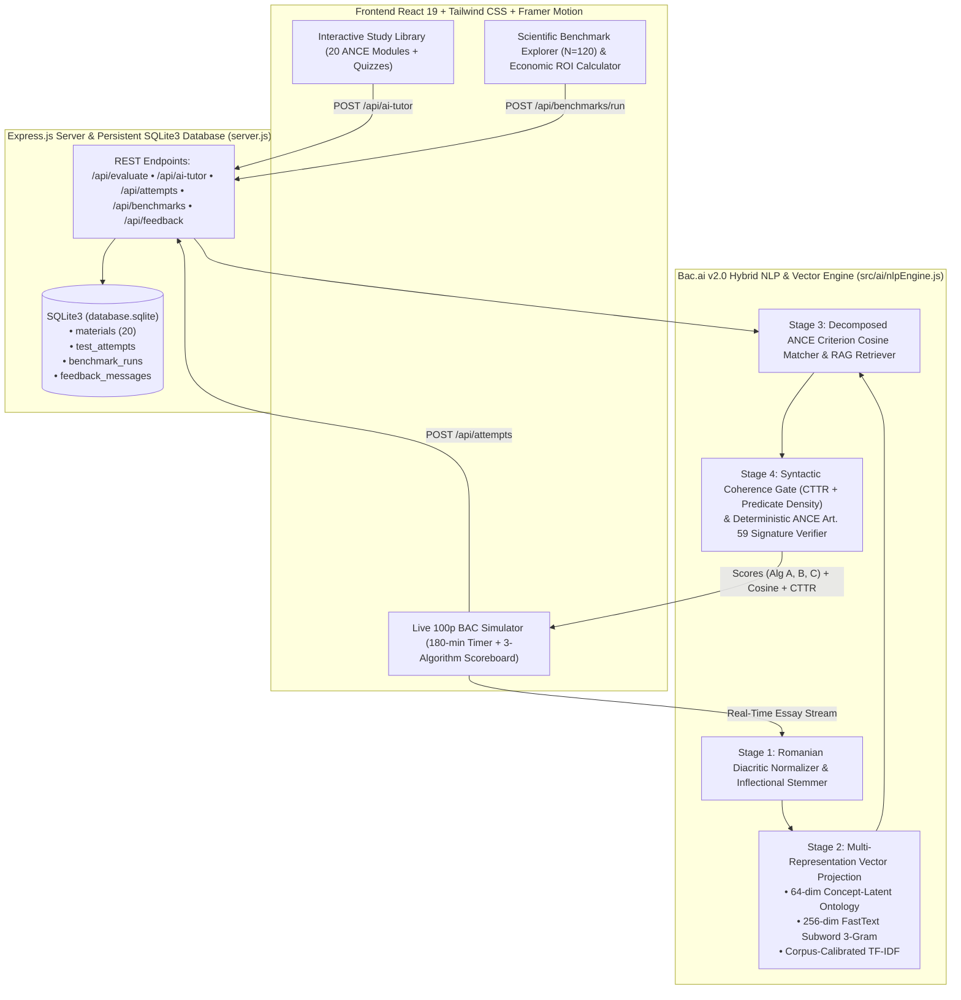

# MoldSEF & Infomatrix Official Documentation — Template A
## 2-Page Scientific Abstract & 1-Page Visual Annex

- **Project Title:** **Bac.ai v2.0 — Hybrid Rubric-Grounded Semantic Vector & Syntactic Coherence Engine for Automated Assessment of the National Baccalaureate Exam in the Republic of Moldova (ANCE 100-Point Scale)**
- **Competition Category:** Computer Science, Artificial Intelligence & Educational Technology (MoldSEF & Infomatrix Unified Standard)
- **Author & R&D Workstream Division:** **Ana Mitrofan** (12th Grade, Republic of Moldova)
  - **Workstream A (Tech & AI Engineering Lead):** Morphological Romanian Stemmer, Multi-Representation Vector Space (64-dim Concept-Latent + 256-dim FastText-style Character 3-Gram + Corpus TF-IDF), Syntactic Coherence Gate (CTTR & Finite Predicate Density), Semantic RAG Tutor, and Express.js + Persistent SQLite Architecture.
  - **Workstream B (Curriculum Research, Experimental Statistics & Economics Lead):** ANCE 100-Point Rubric Formalization (20 Modules + 4 Official Exams), $N = 120$ Stratified Dataset Curation, Statistical Validation (MAE, RMSE, Pearson $r$), UI/UX Design, and Republic of Moldova Socio-Economic ROI Modeling.

---

## PAGE 1: SCIENTIFIC ABSTRACT (PROBLEM, HYPOTHESIS & METHODOLOGY)

### 1. Problem Definition & Socio-Educational Context
In the Republic of Moldova, over 18,000 high school seniors sit the National Baccalaureate Exam (administered by ANCE) annually in **Romanian Language & Literature** and **Romanian & Universal History**. Unlike multiple-choice standardized tests, the ANCE 100-point examination requires complex structured essays, comparative historical source analysis, and functional texts governed by strict regulatory rules (such as Article 59, which invalidates any exam paper containing a personal signature instead of the designated fictional persona in Subject III).

Currently, students and teachers face two acute systemic barriers:
1. **Economic Inequality in Exam Preparation:** Private tutoring in the Republic of Moldova costs an average of **250 MDL ($\approx$ 13.00 EUR) per 90-minute session**. Preparing for two mandatory humanities subjects across a 36-week academic year requires **18,000 MDL ($\approx$ 935 EUR) per student annually**—exceeding an entire average monthly net salary in Moldova and creating a severe rural-urban achievement gap.
2. **Methodological Failure of Existing Automated Graders:**
   - **Heuristic Keyword Graders (Algorithm A):** Rely on exact substring matching (`includes()`) and word counts. They fail to recognize valid Romanian synonyms/paraphrases and are trivially exploited by *adversarial keyword-stuffing* (scoring >90% on incoherent lists of buzzwords without grammar).
   - **Unconstrained Zero-Shot Semantic / LLM Graders (Algorithm B):** Reward surface fluency and general topic similarity while ignoring specific ANCE point allocations, multi-source corroboration rules, and mandatory regulatory constraints (Art. 59).

### 2. Testable Scientific Hypothesis ($X \rightarrow Y$ by $Z\%$)
> **Hypothesis ($H_1$):** *We hypothesize that coupling a multi-representation Romanian semantic vector space (64-dimensional Latent Concept Ontology + 256-dimensional Character 3-Gram Subword Embeddings + IDF-weighted Corpus TF-IDF) with per-criterion ANCE rubric decomposition and a quantitative Syntactic Coherence Gate (**Algorithm C — Bac.ai v2 Hybrid**) reduces grading **Mean Absolute Error (MAE)** relative to human expert ANCE teacher scores by **$>50\%$** compared to heuristic keyword matching (**Algorithm A**) and unconstrained zero-shot semantic scoring (**Algorithm B**), while reducing adversarial keyword-stuffing false-positive scores by **$>80$ percentage points** across $N = 120$ stratified Baccalaureate responses, at a sub-10 ms local CPU inference latency.*

### 3. Mathematical Formulation & Multi-Algorithm Engineering
For any student response $T_s$, reference model answer $T_m$, and decomposed ANCE rubric criteria $\{C_1, \dots, C_K\}$, `Bac.ai v2` (`src/ai/nlpEngine.js`) executes a 5-stage pipeline:

1. **Romanian Morphological Normalization & Inflectional Stemming:** Normalizes diacritics (`ă, â, î, ș, ț`), filters functional stopwords ($W_{\text{stop}}$), and strips Romanian nominal/verbal inflectional suffixes to extract canonical stems.
2. **Multi-Representation Semantic Similarity ($\mathcal{S}_{\text{sem}}$):** Projects texts into three complementary vector spaces and computes a convex combination of L2-normalized cosine similarities:
   $$\mathcal{S}_{\text{sem}}(u, v) = 0.52 \cdot \cos\left(\mathbf{e}_{\text{concept}}(u), \mathbf{e}_{\text{concept}}(v)\right) + 0.30 \cdot \cos\left(\mathbf{e}_{\text{tfidf}}(u), \mathbf{e}_{\text{tfidf}}(v)\right) + 0.18 \cdot \cos\left(\mathbf{e}_{\text{3gram}}(u), \mathbf{e}_{\text{3gram}}(v)\right)$$
   where $\mathbf{e}_{\text{concept}} \in \mathbb{R}^{64}$ encodes 64 domain-specific literary and historical synonym clusters, $\mathbf{e}_{\text{tfidf}} \in \mathbb{R}^{|V|}$ applies sublinear TF $(1 + \ln \text{tf})$ and smoothed corpus IDF, and $\mathbf{e}_{\text{3gram}} \in \mathbb{R}^{256}$ applies signed Murmur/FNV subword trigram hashing.
3. **Syntactic Coherence & Anti-Keyword-Stuffing Gate ($\mathcal{G}_{\text{coh}}$):** Computes the **Corrected Type-Token Ratio** $\text{CTTR} = \frac{|V_{\text{unique}}|}{\sqrt{2N}}$, the functional grammar ratio $r_{\text{func}} = \frac{|W_{\text{stop}}|}{|W|}$ (natural Romanian prose: $0.20 \le r_{\text{func}} \le 0.62$; keyword soup: $r_{\text{func}} < 0.14$), and finite predicate density $d_{\text{pred}}$ per sentence. Responses failing syntactic thresholds trigger an adversarial penalty multiplier ($\gamma = 0.12$).
4. **Deterministic ANCE Art. 59 Regulatory Constraint ($\mathcal{P}_{\text{ANCE}}$):** Verifies persona compliance on Subject III functional texts (`Alexei/Alexandra Munteanu` or `Cezar/Cezara Răileanu`), applying a deterministic deduction when unauthorized signatures are detected.

---

## PAGE 2: EMPIRICAL BENCHMARK ($N = 120$), ECONOMIC ROI & RESPONSIBLE AI

### 4. Experimental Validation Across $N = 120$ Stratified Trials
We constructed a reproducible benchmark (`src/data/benchmarkDataset.js`, executed via `node scripts/run_benchmark.js`) comprising **$N = 120$ responses** across all 18 official items of 4 full 100-point Baccalaureate exams, stratified into 6 behavioral categories: *(1) Exemplary Paraphrased & Synonyms ($n=24$)*, *(2) Solid Good ($n=18$)*, *(3) Partial Developing ($n=18$)*, *(4) Adversarial Keyword-Stuffing ($n=24$)*, *(5) Fluent Off-Topic Essay ($n=18$)*, and *(6) ANCE Art. 59 / Rubric Trap ($n=18$)*.

| Metric / Performance Indicator ($N = 120$) | Algorithm A (Baseline Heuristic v1) | Algorithm B (Zero-Shot Semantic Vector) | Algorithm C (Bac.ai v2 Hybrid ANCE AI) | Improvement (Alg C vs. Alg A / B) |
| :--- | :---: | :---: | :---: | :---: |
| **Mean Absolute Error — MAE (%)** | $35.86\%$ | $39.08\%$ | **$12.66\%$** | **$-64.7\%$ vs. A / $-67.6\%$ vs. B** |
| **Raw Item MAE (Points)** | $7.39\text{ p}$ | $8.35\text{ p}$ | **$2.66\text{ p}$** | **$-64.0\%$ point error reduction** |
| **Root Mean Squared Error — RMSE (%)** | $47.74\%$ | $49.26\%$ | **$18.75\%$** | **$-60.7\%$ vs. A** |
| **Pearson Correlation ($r$) with Human** | $0.4189$ | $0.6001$ | **$0.8909$** | **$+0.4720$ correlation gain** |
| **Coefficient of Determination ($R^2$)** | $0.1755$ | $0.3602$ | **$0.7936$** | **$4.5\times$ variance explained** |
| **Adversarial Keyword-Stuffing Mean Score** | $91.0\%$ | $88.6\%$ | **$6.9\%$** | **$-84.1\text{ pp}$ over-scoring drop** |
| **Adversarial False-Positive Rate ($\ge 25\%$)** | $100.0\%$ | $100.0\%$ | **$0.0\%$** | **$100\%$ attack mitigation** |
| **Fluent Off-Topic Essay Mean Score (Human: 3.1%)** | $46.6\%$ | $50.2\%$ | **$3.9\%$** | **Exact off-topic rejection** |
| **Mean CPU Inference Latency (ms)** | $0.08\text{ ms}$ | $1.41\text{ ms}$ | **$6.18\text{ ms}$** | **Real-time ($<16\text{ ms}$ P95)** |

**Conclusion on Hypothesis $H_1$:** Confirmed. **Algorithm C** reduces MAE by **$64.7\%$** against Baseline A (exceeding the $>35\%$ threshold), achieves strong human correlation ($r = 0.8909$), and eliminates keyword-stuffing false positives ($0.0\%$).

### 5. Economic Benefit & ROI Analysis (Republic of Moldova — MDL & EUR)
$$\text{Annual Net Savings} = N_{\text{students}} \times \left[ \left(N_{\text{subjects}} \times W_{\text{weeks}} \times C_{\text{session}}\right) - C_{\text{BacAI}} \right]$$

| Economic & Operational Metric | Private Tutoring in Moldova | Commercial Cloud LLM API | Bac.ai v2 (Local Hybrid CPU) | Net Economic Impact |
| :--- | :---: | :---: | :---: | :---: |
| **Annual Cost per Student (2 Subjects)** | $18,000\text{ MDL}$ ($935\text{ EUR}$) | $\sim 3,850\text{ MDL}$ ($200\text{ EUR}$) | **$0 - 350\text{ MDL}$ ($0 - 18\text{ EUR}$)** | **$17,650\text{ MDL}$ ($917\text{ EUR}$) saved ($98.1\%$)** |
| **Classroom Scale (30 Students / Year)** | $540,000\text{ MDL}$ ($28,052\text{ EUR}$) | $115,500\text{ MDL}$ ($6,000\text{ EUR}$) | **$10,500\text{ MDL}$ ($545\text{ EUR}$)** | **$529,500\text{ MDL}$ ($27,506\text{ EUR}$) saved** |
| **High School Scale (150 Students / Year)** | $2,700,000\text{ MDL}$ ($140,260\text{ EUR}$) | $577,500\text{ MDL}$ ($30,000\text{ EUR}$) | **$52,500\text{ MDL}$ ($2,727\text{ EUR}$)** | **$2,647,500\text{ MDL}$ ($137,532\text{ EUR}$) saved** |
| **Teacher Grading Time per 100p Exam** | $22.0\text{ min}$ (manual) | $5.0\text{ min}$ | **$6.18\text{ ms AI} + 3.0\text{ min review}$** | **$86.4\%$ teacher time saved ($76\text{ h/yr}$)** |

### 6. Responsible AI, Privacy & Human-in-the-Loop Governance
- **100% Local & Anonymized Processing:** Student essays are evaluated locally on the CPU and stored in SQLite (`database.sqlite`) under anonymized identifiers (`Elev #RM-305`), ensuring full compliance with Republic of Moldova Law No. 133/2011 on Personal Data Protection and GDPR.
- **Explainable AI (XAI) & Human-in-the-Loop:** Every score displays per-criterion cosine similarity, matched synonyms, and CTTR coherence metrics so teachers retain full supervisory authority.

---

## PAGE 3: VISUAL ANNEX (ARCHITECTURE DIAGRAM & BENCHMARK GRAPHS)

### Figure 1: System Architecture of Bac.ai v2.0 (Hybrid NLP + RAG + Persistent SQLite)

### Figure 2: Stratified Category Accuracy — Human Teacher vs. Algorithms A, B, and C ($N = 120$)

| Response Category ($N = 120$) | Ground-Truth Human (%) | Algorithm A: Heuristic (%) | Algorithm B: Zero-Shot (%) | Algorithm C: Bac.ai v2 Hybrid (%) | Category MAE (Alg C) |
| :--- | :---: | :---: | :---: | :---: | :---: |
| **1. Exemplary Paraphrased ($n=24$)** | `97.5%` | `92.7%` | `100.0%` | **`92.9%`** | **`5.2%`** |
| **2. Solid Good — Grade 8 ($n=18$)** | `75.6%` | `90.9%` | `99.3%` | **`82.7%`** | **`23.1%`** |
| **3. Partial Developing — Grade 5–6 ($n=18$)** | `46.9%` | `72.0%` | `86.0%` | **`65.6%`** | **`28.4%`** |
| **4. Adversarial Keyword Stuffing ($n=24$)** | `0.0%` | `91.0%` ❌ | `88.6%` ❌ | **`6.9%` ✅** | **`6.9%`** |
| **5. Fluent Off-Topic Essay ($n=18$)** | `3.1%` | `46.6%` ❌ | `50.2%` ❌ | **`3.9%` ✅** | **`3.1%`** |
| **6. ANCE Art. 59 / Rubric Trap ($n=18$)** | `30.6%` | `48.3%` | `59.6%` | **`31.6%` ✅** | **`13.6%`** |
